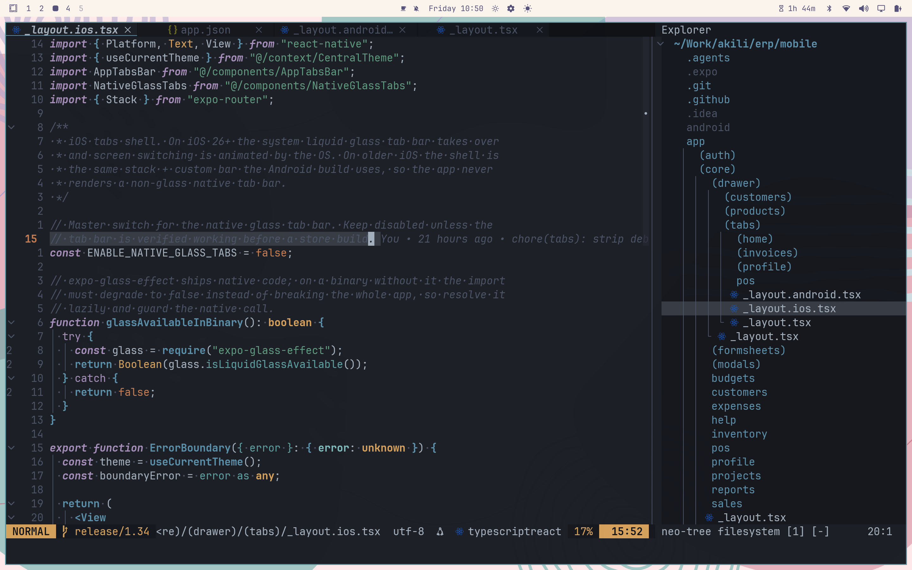

# Neovim Config VS Code Experience on Neovim

<!--toc:start-->
- [Neovim Config VS Code Experience on Neovim](#neovim-config-vs-code-experience-on-neovim)
  - [Structure](#structure)
  - [VS Code Keybindings](#vs-code-keybindings)
  - [Leader Keybindings](#leader-keybindings)
  - [LSP Mappings](#lsp-mappings)
  - [Theme Switching](#theme-switching)
  - [Installation](#installation)
    - [1. Install Neovim 0.10+](#1-install-neovim-010)
    - [2. Clone the config](#2-clone-the-config)
    - [3. Sync plugins + health check](#3-sync-plugins-health-check)
    - [4. Dependencies](#4-dependencies)
    - [Optional: Neovide (GUI)](#optional-neovide-gui)
<!--toc:end-->



A modular Neovim configuration designed for developers coming from VS Code. Everything should feel familiar while embracing Neovim's strengths.

> **New here?** Read **[HOW_TO.md](HOW_TO.md)** — a full walk-through guide from install to daily usage.

## Structure

```
~/.config/nvim/
├── init.lua                    # Entry point
├── lua/
│   ├── core/                   # Core settings
│   │   ├── options.lua         # Editor options
│   │   ├── keymaps.lua         # Core keymaps
│   │   ├── autocmds.lua        # Autocommands
│   │   └── vscode-keybindings.lua  # VS Code compatible keybindings
│   └── plugins/                # Plugin configs (auto-loaded by lazy.nvim)
│       ├── init.lua            # Plugin list / imports
│       ├── telescope.lua       # Fuzzy finder
│       ├── lsp.lua             # LSP (lspconfig, mason, formatters)
│       ├── blink.lua           # Autocompletion
│       ├── neo-tree.lua        # File explorer (sidebar)
│       ├── treesitter.lua      # Syntax highlighting
│       ├── conform.lua         # Format on save
│       ├── toggleterm.lua      # Integrated terminal
│       ├── gitsigns.lua        # Git signs in gutter
│       ├── lualine.lua         # Status line
│       ├── bufferline.lua      # Tab bar
│       ├── which-key.lua       # Keybinding hints
│       ├── trouble.lua         # Diagnostics panel
│       ├── noice.lua           # Modern UI (cmdline, messages)
│       ├── notify.lua          # Notification system
│       ├── dashboard.lua       # Welcome screen
│       ├── persistence.lua     # Session management
│       ├── todo-comments.lua   # TODO/FIXME highlighting
│       ├── flash.lua           # Motion navigation
│       ├── mini.lua            # Text objects, surround, pairs, statusline
│       ├── comment.lua         # Comment toggling
│       ├── spectre.lua         # Search & replace across files
│       ├── aicommits.lua       # AI commit messages (OpenCode Go)
│       ├── snacks.lua          # QoL: smooth scroll, zen mode, lazygit, images
│       ├── tailwind-tools.lua  # Tailwind CSS intellisense
│       ├── lint.lua            # Linting (phpstan, eslint, golangci-lint…)
│       ├── neotest.lua         # Test runner (phpunit, jest, golang)
│       ├── laravel.lua         # Laravel tooling (routes, artisan, tinker…)
│       ├── rustaceanvim.lua    # Rust-analyzer extras
│       ├── crates.lua          # Cargo.toml crate management
│       ├── gopher.lua          # Go tools (tags, iferr, tests)
│       ├── scrollbar.lua       # Scrollbar with diagnostics/git/search marks
│       ├── smear-cursor.lua    # Animated cursor trail (Neovide-style)
│       ├── project.lua         # Project management
│       ├── colorscheme.lua     # Color schemes & theme switcher
│       └── extra.lua           # DAP, neogit, outline, multicursor
└── lazy-lock.json              # Plugin lockfile
```

## VS Code Keybindings

| Key | Action |
|-----|--------|
| `Ctrl+S` | Save |
| `Cmd+S` | Save & exit insert mode (macOS) |
| `Ctrl+Shift+S` | Save all |
| `Ctrl+Z` / `Ctrl+Y` | Undo / Redo |
| `Ctrl+X` / `Ctrl+C` / `Ctrl+V` | Cut / Copy / Paste |
| `Ctrl+A` | Select all |
| `Ctrl+P` | Quick open files |
| `Ctrl+Shift+P` | Command palette |
| `Ctrl+F` | Find in file |
| `Ctrl+R` | Replace in file |
| `Ctrl+Shift+F` | Find in files |
| `Ctrl+Shift+H` | Replace in files (Spectre) |
| `Ctrl+G` | Go to line |
| `Ctrl+B` | Toggle file explorer (right side) |
| `Ctrl+Shift+E` | Focus file explorer |
| `Ctrl+0` | Focus sidebar |
| `Ctrl+1` | Focus editor |
| `Ctrl+`` ` | Toggle terminal (float) |
| `Ctrl+/` | Toggle comment |
| `Ctrl+K Ctrl+C` / `Ctrl+K Ctrl+U` | Comment / uncomment (chord) |
| `Ctrl+D` | Add next cursor (multi-cursor) |
| `Ctrl+Up` / `Ctrl+Down` | Add cursor up / down |
| `Ctrl+Enter` / `Ctrl+Shift+Enter` | Insert line below / above |
| `Ctrl+Shift+K` | Delete line |
| `Ctrl+]` / `Ctrl+[` | Indent / outdent |
| `Ctrl+Tab` / `Ctrl+Shift+Tab` | Next / previous editor |
| `Ctrl+N` | New untitled buffer |
| `Ctrl+Shift+W` | Close editor |
| `Ctrl+Shift+T` | Reopen closed editor |
| `:e path/to/new/file.ts` + `:w` | Create file & dirs (auto `mkdir -p`) |
| `v` / `V` / `<C-v>` | Select char / line / block |
| `Shift+arrows` | Extend selection (VSCode-style) |
| `d` / `dd` / `x` | Delete selection / line / char |
| `Ctrl+X` | Cut (visual mode) |
| `Ctrl+Shift+K` | Delete line |
| `Ctrl+Shift+G` | Source control (Neogit) |
| `Ctrl+Shift+M` | Show problems (Trouble) |
| `Ctrl+Shift+O` | File symbols |
| `Ctrl+T` | Workspace symbols |
| `Ctrl+Shift+R` | Recent files |
| `Ctrl+=` / `Ctrl+-` | Zoom in / out |
| `Alt+Up` / `Alt+Down` | Move line up / down |
| `Alt+Shift+F` | Format document |
| `Alt+F12` | Peek definition |
| `Alt+Z` | Toggle word wrap |
| `F2` | Rename symbol |
| `F12` | Go to definition |
| `Shift+F12` / `gpr` | Find references in a popup (peek outside the file) |
| `F8` / `Shift+F8` | Next / previous problem |
| `F5` / `F9` / `F10` / `F11` | Debug: continue / breakpoint / step over / step into |
| `Ctrl+. `, | Quick fix (code action) |
| `Ctrl+,` | Open settings |

> On macOS, `Ctrl` mirrors to `Cmd` automatically for these bindings.

## Leader Keybindings

| Key | Action |
|-----|--------|
| `<space>sh` | Search help |
| `<space>sk` | Search keymaps |
| `<space>sf` | Search files |
| `<space>sg` | Live grep |
| `<space>sw` | Search current word |
| `<space>sd` | Search diagnostics |
| `<space>sr` | Resume search |
| `<space>s.` | Recent files |
| `<space>sn` | Search neovim files |
| `<space><space>` | Find buffers |
| `<space>/` | Fuzzy search in buffer |
| `<space>sp` | Spectre toggle |
| `<space>sW` | Spectre word / selection |
| `<space>e` | Toggle file explorer |
| `<space>xx` | Toggle trouble (diagnostics) |
| `<space>gg` | Open git UI (neogit) |
| `<space>gc` / `<space>gp` / `<space>gl` | Git commit / push / pull |
| `<space>gd` | Diffview: review uncommitted changes |
| `<space>gD` | Close Diffview |
| `<space>gh` | Diffview: file history of current file |
| `<space>ga` | AI commit message (aicommits via OpenCode Go) |
| `<space>lg` | Lazygit in a floating window |
| `<space>uz` | Toggle zen mode (distraction-free) |
| `<space>gb` | Toggle git blame |
| `<space>nt` / `<space>nT` / `<space>nR` | Test: nearest / file / all (neotest) |
| `<space>ns` / `<space>no` | Test: summary / output |
| `<space>ll` | Laravel master picker |
| `<space>la` / `<space>lr` / `<space>lm` / `<space>lo` | Laravel: artisan / routes / make / resources |
| `<space>lt` / `<space>lu` / `<space>lp` | Laravel: code actions / artisan hub / command center |
| `<space>pp` | Project switcher |
| `<space>qs` / `<space>ql` / `<space>qd` | Restore / restore last / stop session |
| `<space>tt` | Theme picker |
| `<space>tv` / `<space>to` / `<space>tc` / `<space>tg` / `<space>tD` / `<space>tn` | VSCode / Tokyo Night / Catppuccin / Gruvbox / Dracula / Nord |
| `<space>tf` / `<space>tV` / `<space>th` | Floating / vertical / horizontal terminal |
| `<space>f` | Format buffer |
| `<space>o` | Toggle outline |
| `<space>du` | Toggle debug UI |
| `<space>ti` | Toggle inlay hints (LSP buffer) |
| `<space>hs` / `<space>hr` / `<space>hp` / `<space>hb` | Git hunk stage / reset / preview / blame |

## LSP Mappings

| Key | Action |
|-----|--------|
| `grd` / `F12` | Go to definition |
| `gD` | Go to definition in **vsplit** (read std source) |
| `gH` | Go to definition in **hsplit** |
| `grr` | Find references (list) |
| `gpr` / `Shift+F12` | Find references in popup |
| `<space>ci` | Organize imports |
| `gri` / `gI` | Go to implementation (in-place / vsplit) |
| `grn` / `F2` | Rename |
| `gra` / `Ctrl+.` | Code action |
| `K` | Hover documentation |
| `Ctrl+K` | Signature help |
| `gO` / `Ctrl+Shift+O` | Document symbols |
| `gW` / `Ctrl+T` | Workspace symbols |
| `<space>o` | Toggle outline panel |
| `<space>ti` | Toggle inlay hints |

## Theme Switching

| Key | Theme |
|-----|-------|
| `<space>tt` | Theme picker (Telescope) |
| `<space>tc` | Catppuccin (Mocha) — **default** |
| `<space>to` | Tokyo Night |
| `<space>tv` | VSCode |
| `<space>tg` | Gruvbox |
| `<space>tD` | Dracula |
| `<space>tn` | Nord |

## Installation

### 1. Install Neovim 0.10+

Neovide / nightly users: install the latest Neovim release tree (the config is tested against Neovim 0.13 nightly — install the full release tree, not just the binary).

**Arch Linux (AUR — recommended, keeps you on the latest stable/nightly):**

```sh
yay -S neovim-git          # or: sudo pacman -S neovim
```

**Ubuntu / Debian (PPA):**

```sh
sudo add-apt-repository ppa:neovim-ppa/unstable && sudo apt update && sudo apt install neovim
```

**Any platform — official build (full tree into ~/.local):**

```sh
curl -LO https://github.com/neovim/neovim/releases/latest/download/nvim-linux-x86_64.tar.gz
mkdir -p ~/.local/nvim && tar -C ~/.local/nvim --strip-components=1 -xzf nvim-linux-x86_64.tar.gz
ln -sfn ~/.local/nvim/bin/nvim ~/.local/bin/nvim
```

### 2. Clone the config

```sh
git clone https://github.com/tacheraSasi/0xVim.git ~/.config/nvim
```

### 3. Sync plugins + health check

```sh
nvim --headless "+Lazy! sync" +qa
nvim --headless '+checkhealth' +qa   # optional: verify everything is green
```

### 4. Dependencies

- `git`, `ripgrep` (`sudo pacman -S ripgrep`) — Telescope live grep
- A [Nerd Font](https://www.nerdfonts.com/) and a terminal that supports it (icons)
- Node.js ≥ 18 — Mason-installed LSP servers (ts/js, vue)
- Language tooling as needed: `go`, `rust-analyzer` + `cargo`, `php` + `composer`, `zig` (zls), `gopls`, `stylua`, `prettierd` (Mason installs most of these on first run)

### Optional: Neovide (GUI)

Works out of the box — `lua/core/neovide.lua` applies cursor/scroll animation and
performance tuning automatically when run inside Neovide. Use Neovide 0.16+ (it
renamed `neovide_transparency` to `neovide_opacity`).

```sh
yay -S neovide        # or neovide-nightly-bin for matching a Neovim nightly
```

> The config is tuned for Neovim 0.13 nightly. On a Neovim 0.10/0.11 stable
> everything should still work; if an option is missing, check the changelogs.
